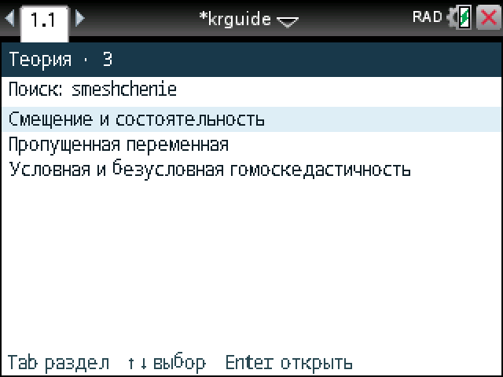

# TI-Nspire workarounds

Build TI-BASIC libraries and Lua documents as `.tns` files on a desktop. This repository covers three problems that show up on a handheld: getting TI OS to register a generated library, displaying Cyrillic through a bitmap font, and searching Russian text from a Latin keypad. The examples include source files, build scripts and screenshots from [Firebird](https://github.com/nspire-emus/firebird).



## Build a document

Use Bash, Git, Make, a C compiler and the zlib development headers. Python 3 is also required for the generated example. From the repository root, build [Luna](https://github.com/ndless-nspire/Luna) at the revision used for the tested documents.

```sh
git clone https://github.com/ndless-nspire/Luna.git tools/Luna
git -C tools/Luna checkout a9924a9a968954eba9adcc161a58ac607f97ce8c
make -C tools/Luna
./scripts/build.sh econ
./scripts/build-lua.sh economics
```

The first script packages `libs/econ/Document.xml` and `Problem1.xml` as `build/econ.tns`. The second turns a standalone Lua script into `build/economics.tns`. To use an existing Luna installation, run e.g. `LUNA=/path/to/luna ./scripts/build.sh econ`. Run `./scripts/build-all.sh` to build every library, both standalone Lua documents and the econometrics example.

## Workarounds by symptom

| What happens on the calculator | Where to look |
| --- | --- |
| A generated document opens, but a library function is missing after Refresh Libraries | Check the symbol XML, line separators and reserved TI names. Start with the [format and debugging guide](docs/README.md). |
| Cyrillic labels do not render with the system font | The [Lua handbook](examples/econometrics/handbook.lua) draws glyphs from a [bitmap table](examples/econometrics/font.lua). The same glyph widths drive wrapping and scrolling. |
| The keyboard has no Cyrillic keys | An offline, field-weighted BM25 index ranks theory, methods, worked solutions and individual solvers together, including problem wording in transliteration. Typing `smeshchenie` or `smeschenie` finds «Смещение». [On-device example and controls](examples/econometrics/README.md) |
| The desktop build succeeds, but a calculation fails on TI OS | Use the [on-device smoke test](examples/econometrics/tests/krcheck.lua) to call the installed libraries through the calculator's own math engine. [Recorded result](examples/econometrics/tests/evidence/c-result1.png) |

## Install the working example

[Download the econometrics example](https://github.com/3Jlou4eJluk/ti_program_build/raw/refs/heads/main/downloads/econometrics-cx-ii-t.zip). If you already have its four MyLib libraries from the first GitHub bundle, you can [update only the handbook](https://github.com/3Jlou4eJluk/ti_program_build/raw/refs/heads/main/downloads/krguide.tns). Extract it on your computer. Copy the four files in `MyLib/` to the calculator's `MyLib` folder, copy `krguide.tns` to a document folder, then select **Doc → Refresh Libraries**. Open the handbook, or enter this call in Calculator to get the area under a step ROC curve and its Gini coefficient.

```text
krroc\steparea({0,.3,1},{.3,1})  →  {.79,.58}
```

The example targets the **TI-Nspire CX II-T without CAS**. The recorded Firebird run used a **first-generation TI-Nspire CX without CAS, OS 4.5.5.79**, and passed **55 of 55** numerical checks. It also exercised Cyrillic rendering, transliterated input and copying a function call. To repeat the checks on a CX II-T, place the [test document](https://github.com/3Jlou4eJluk/ti_program_build/raw/refs/heads/main/downloads/krcheck.tns) in a regular documents folder after installation, open it and press **Enter**. A run on the exact CX II-T model is still pending. [Handheld model](examples/econometrics/tests/evidence/model.png) · [OS version](examples/econometrics/tests/evidence/os-version.png)

From Theory, press **Tab** twice for «Как решать» (methods) or three times for «Готовые решения» (worked answers). Methods start with the choice of procedure. Worked answers preserve the data, calculations and conclusions for specific problems, including variants 1–4 of the first test. Theory opens with the answer, followed by intuition and detail. Each solver opens with the inputs and the result it provides. [Russian walkthroughs and worked answers](downloads/how-to-solve.ru.md) · [Worked answers on TI OS](examples/econometrics/tests/evidence/ready-solutions.png) · [Theory card on TI OS](examples/econometrics/tests/evidence/answer-first.png) · [Solver example checks](examples/econometrics/tests/evidence/solver-examples.png).

On a solver card, **H** explains the library and function names. Press **H** again, then **C** to copy the example. In Calculator, paste it with **Ctrl+V** and press **Enter**. For the exact runs test, the example has two runs and a two-sided p-value of 2/3. [Solver card](examples/econometrics/tests/evidence/practice.png) · [Call help](examples/econometrics/tests/evidence/call-help.png) · [Calculator result](examples/econometrics/tests/evidence/runs-result.png)

## Source map

| Path | Contents |
| --- | --- |
| [docs/](docs/README.md) | File-format details, TI OS debugging and historical engineering notes |
| [examples/econometrics/](examples/econometrics/) | A complete non-CAS example with a Russian-language interface, generated TI-BASIC libraries, desktop checks and emulator evidence |
| [libs/](libs/README.md) | Earlier TI-BASIC examples for macroeconomics, input–output models and integer programming |
| [lua/](lua/README.md) | Standalone Lua examples using calculator events and graphics |
| [examples/linalg/](examples/linalg/) and [examples/numtheory/](examples/numtheory/) | Small XML examples for studying the document structure |

## Licensing

The original project README identifies the calculator libraries as MIT-licensed. Luna is distributed separately under MPL 1.1. The bitmap font in the example includes its SIL Open Font License notice.
